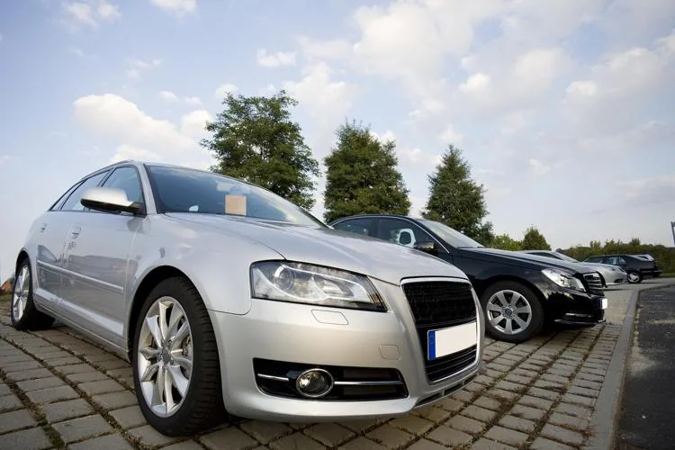

Alba envisage l’achat d’une voiture neuve. Elle souhaite anticiper la perte de valeur de son véhicule avec le temps. Elle hésite entre deux modèles, dont l'évolution des prix peut être modélisée sur 12 ans.

- **Modèle A :** une voiture généraliste fiable, vendue 22 000 €, dont l’évolution du prix au fil des années est modélisée par la fonction $f(x)=22000-1700x$.

- **Modèle B :** une voiture haut de gamme, vendue 38 000 €, mais touchée par un défaut moteur connu. Cela entraîne une forte décote, modélisée par la fonction $g(x)=38000\times 0{,}80^x$.

::: problematique
Au bout de combien d'années les deux voitures auront-elles la même valeur ?
:::

