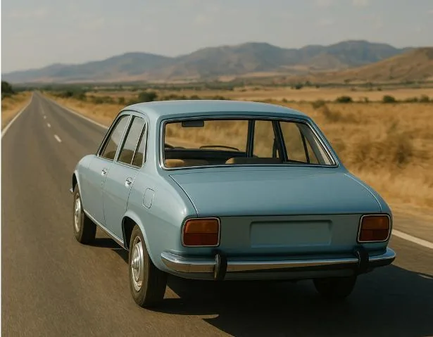

Deux familles organisent ensemble un grand voyage dans le sud. Elles hésitent entre deux solutions pour le trajet.

**Option 1 —** Utilisation des deux voitures familiales

- Elles utilisent leurs propres voitures.
- Chaque voiture consomme 7 L/100 km.
- Le carburant coûte 1,80 €/L.
- Les deux voitures font le trajet.

**Option 2 —** Location d'un minibus

- Le minibus coûte 200 € à la location.
- Il consomme 9 L/100 km.
- Même prix pour le carburant : 1,80 €/L.
- Il transporte tout le monde.

::: problematique
À partir de combien de kilomètres est-il plus rentable de louer le minibus ?
:::

1. On note $x$ la distance parcourue en centaine de kilomètres.

   Exprimer en fonction de $x$ :

   - le coût total $f(x)$ pour les deux voitures ;
   - le coût total $g(x)$ pour le minibus.

2. Tracer les deux fonctions sur l’intervalle $[0\,;30]$ (soit de 0 à 3 000 km).

3. Répondre à la problématique.

   
