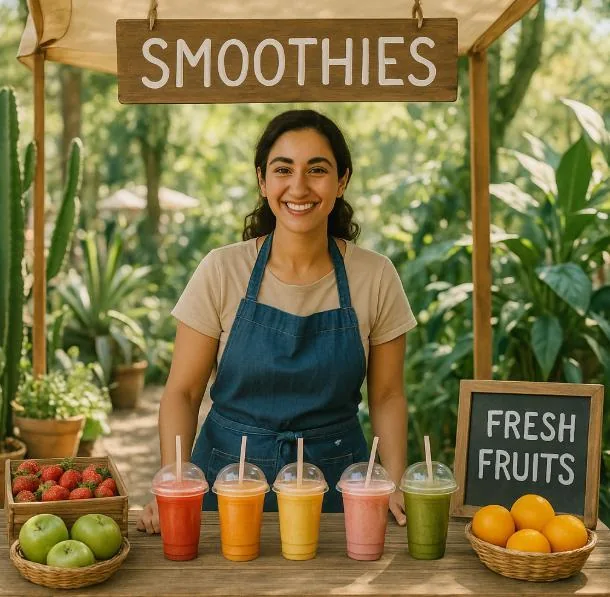

Chaïma fabrique et vend des smoothies artisanaux sur les marchés locaux.

- Chaque bouteille de smoothie lui coûte 2,50 € (fruits, bouteilles, étiquettes, etc.).
- Elle doit payer 75 € par jour pour installer son stand (droit de place, électricité, décoration, etc.).
- Elle vend chaque bouteille 4,50 €.

::: problematique
À partir de combien de bouteilles vendues commence-t-elle à réaliser un bénéfice ?
:::

:::: competence S'approprier

1. On appelle coût total l'ensemble des éléments que l'entrepreneuse devra payer. Quelles informations sont nécessaires pour le calculer ?

2. On appelle gain total l'ensemble de l'argent que l'entrepreneuse encaissera. Quelles informations sont nécessaires pour le calculer ?

::::

:::: competence Analyser-raisonner

3. Exprimer le coût total $f(x)$ et le gain total $g(x)$ en fonction de $x$, le nombre de bouteilles vendues.

::::

:::: competence Réaliser

4. Tracer les courbes de $f(x)$ et $g(x)$ sur NumWorks et estimer la valeur pour laquelle $f(x)=g(x)$.

::::

:::: competence Valider

5. Chaïma sait que, en général, il lui faut vendre environ 40 smoothies pour réaliser un bénéfice. Cette information est-elle cohérente avec l'estimation précédente ?

::::

:::: competence Communiquer

6. Un client lui dit : *« Mais à 4,50 € la bouteille, vous devez vous faire plein d’argent ! »*

   Proposer une réponse en expliquant la réalité de l'activité.

   

::::
