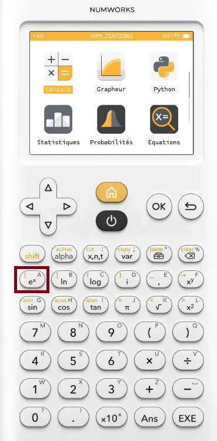

La fonction $f(x) = 10 \times \left(1 - e^{-0{,}3x}\right)$ contient un nouveau terme que vous découvrirez l'an prochain plus en détail, $e$.

Pour tracer la fonction, il faut simplement recopier sa formule en se servant de la touche $e$ de la calculatrice NumWorks.

