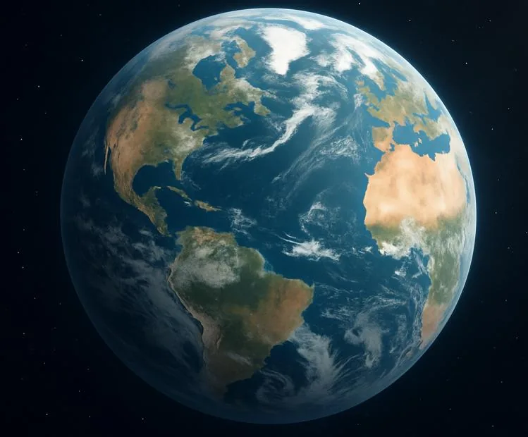

Depuis plusieurs décennies, les scientifiques suivent l’évolution de la température moyenne à la surface de la Terre.

La température utilisée dans cette activité est une moyenne mondiale, c’est-à-dire une estimation de la température moyenne mesurée sur l’ensemble de la planète, en tenant compte à la fois des terres et des océans.

::: problematique
Comment estimer la température moyenne mondiale en 2050 ?
:::

1. Ouvrir le fichier ci-dessous dans un tableur.

   ::: fichier fichiers/temperature-mondiale.xlsx
   :::

2. Tracer la droite de régression de cette série.

   ::: coup-de-pouce m-regression-excel
   :::

3. En s'appuyant sur l'équation de la droite de régression obtenue, estimer la température moyenne mondiale en 2050.
