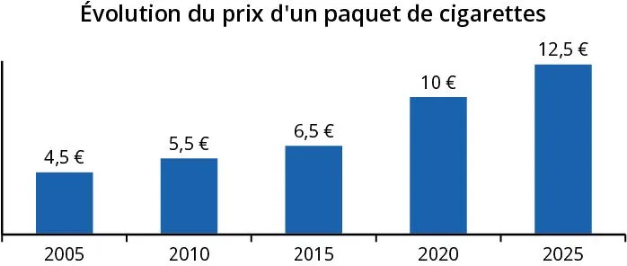

Mathis achète régulièrement des cigarettes et constate que leur prix ne cesse d’augmenter.

::: problematique
Combien coûtera un paquet de cigarettes en 2035 si l'évolution se poursuit à ce rythme ?
:::

1. Calculer l'augmentation du prix d'un paquet de cigarettes entre 2005 et 2025.

2. Représenter la série statistique sous forme de nuage de points.

   ::: coup-de-pouce m-nuage-numworks
   :::

3. Tracer la droite de régression associée à cette série.

   ::: coup-de-pouce m-droite-numworks
   :::

4. Estimer le prix d'un paquet de cigarettes en 2035.

   ::: coup-de-pouce m-prediction-numworks
   :::
