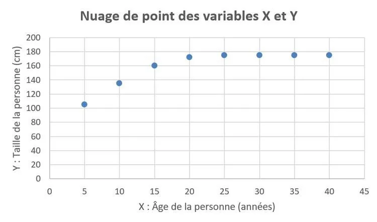

### Qu'est-ce qu'une variable ?

**Définition :** en statistique, une variable est une information que l'on peut observer ou mesurer, et qui peut changer d'une situation à une autre.

Exemples : l'âge d'une personne, son film préféré ou le prix d'un objet sont tous les trois des variables.

### Lien entre deux variables

Dans certaines situations, plusieurs variables sont liées.

**Exemple :** prenons l'âge d'une personne et sa taille. Ce sont deux variables.

Appelons :

- $X$ : la variable contenant l'âge de la personne ;
- $Y$ : la variable contenant la taille de la personne.

On peut se douter intuitivement que lorsque $X$ (l'âge) augmentera, $Y$ (la taille) augmentera puis se stabilisera. En effet, passé 18 ans, on ne grandit plus beaucoup.

Cela donnerait le nuage de points suivant :

