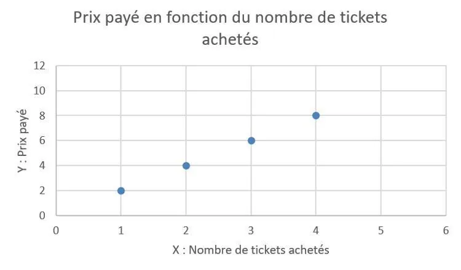
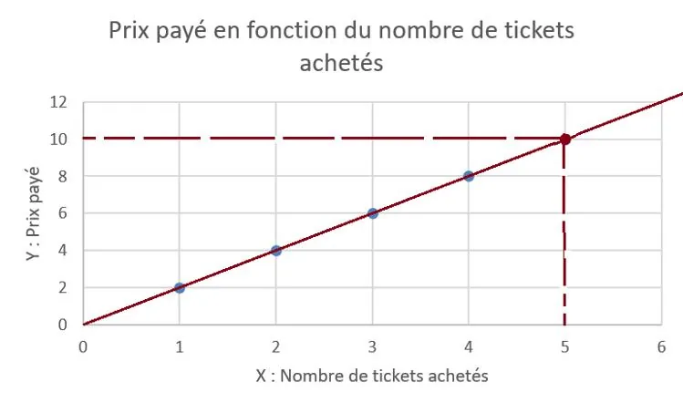
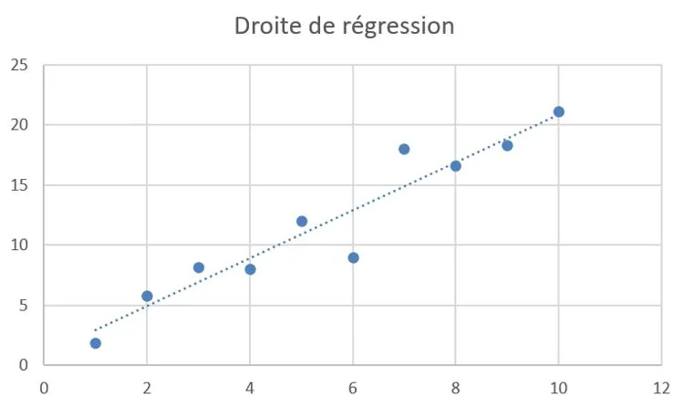

1. **Situation évidente**

   Imaginons que l'on commande un certain nombre de tickets de métro et que l'on s'intéresse au prix que l'on paye. On étudie différentes situations, et on obtient le nuage de points suivant :

   

   Supposons que l'on se demande quel serait le prix payé si l'on achetait 5 tickets. Il paraît logique de répondre que pour 5 tickets, on paiera 10 €. En effet, les 4 premiers points étant alignés, on peut construire la droite les reliant et en déduire le cinquième. C'est cette droite que l'on appelle « droite de régression » ou « ajustement affine ».

   

2. **Situation plus complexe**

   Il arrive que le lien entre les données ne soit pas linéaire. Il n'est alors pas si évident de tracer la droite de régression. Il faut en effet tracer précisément la droite passant au plus proche de tous les points. On fait alors appel à des outils numériques comme Excel ou NumWorks pour la tracer.

   

   **Remarques**

   - On appelle extrapolation le fait de rechercher une valeur en dehors du nuage de points.
   - On appelle interpolation le fait de rechercher une valeur à l'intérieur du nuage de points.
