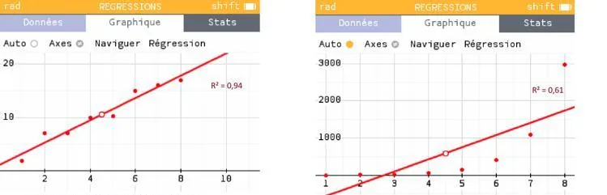

Il n’est pas toujours pertinent de représenter une série statistique par une droite de régression : cela dépend de la forme du nuage de points.

**Exemple**

Le nuage de points de gauche s’aligne visiblement selon une direction, ce qui rend pertinent l’usage d’une droite de régression pour résumer la tendance. En revanche, dans le nuage de points de droite, les points ne semblent pas suivre de direction linéaire claire : une droite ne serait donc pas un modèle adapté.

### Coefficient de détermination $R^2$

Cette intuition peut être confirmée de manière plus rigoureuse grâce au coefficient de détermination $R^2$. Il permet de mesurer dans quelle mesure la droite de régression représente bien les données.

::: important
Ce coefficient est toujours compris entre 0 et 1. Plus sa valeur est proche de 1, plus la droite est un bon résumé de la série statistique ; à l’inverse, une valeur proche de 0 indique que la droite est peu pertinente.
:::

**Exemple**

- Le nuage de points de gauche a un coefficient de détermination $R^2 = 0{,}94$. Cette valeur est proche de 1. La droite résume donc plutôt bien la série.
- Le nuage de points de droite, quant à lui, a un coefficient de détermination $R^2=0{,}61$. Cette valeur est plus éloignée de 1. La droite résume donc plutôt mal la série.
