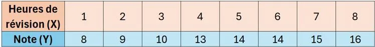

On a étudié la relation entre le nombre d'heures de révision $(X)$ et la note obtenue à un devoir noté sur 20 $(Y)$. Voici les résultats pour 8 élèves.

L'équation de la droite de régression est $Y=1{,}18X+7{,}07$ et le coefficient de détermination vaut $R^2 = 0{,}94$.

1. En s'appuyant sur la valeur du $R^2$, déterminer si le modèle est pertinent.

2. En s'appuyant sur l'équation de la droite, calculer la note obtenue si un élève avait révisé pendant 15 heures. Ce résultat est-il cohérent avec la situation ?
