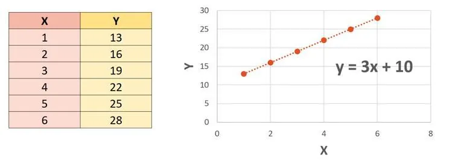

On étudie les variables $X$ et $Y$ suivantes dont on a établi la droite de régression.

1. Prédire la valeur de $Y$ si $X = 8$. On s'appuiera sur l'équation de la droite de régression.

2. Prédire la valeur de $X$ si $Y = 17{,}5$.
