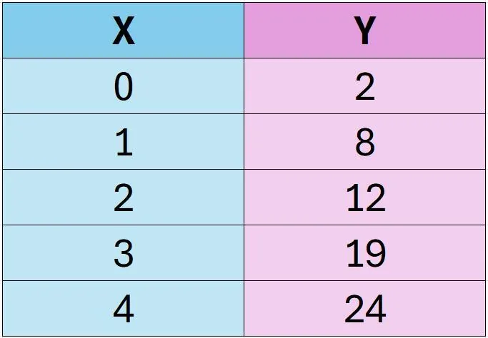

On étudie deux variables $X$ et $Y$ définies ainsi.

1. Tracer le nuage de points sur NumWorks.

2. Afficher la droite de régression.

3. Réaliser une prédiction sachant que $X=2{,}5$.

4. Réaliser une prédiction sachant que $Y=6$.
