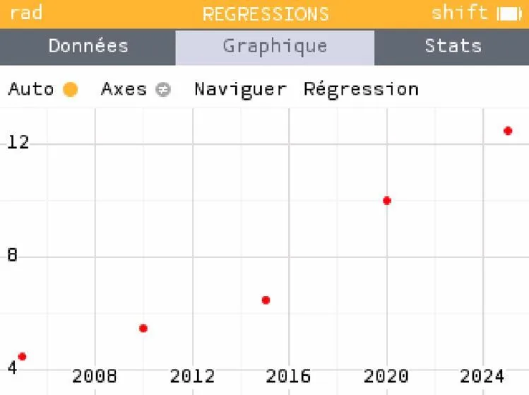
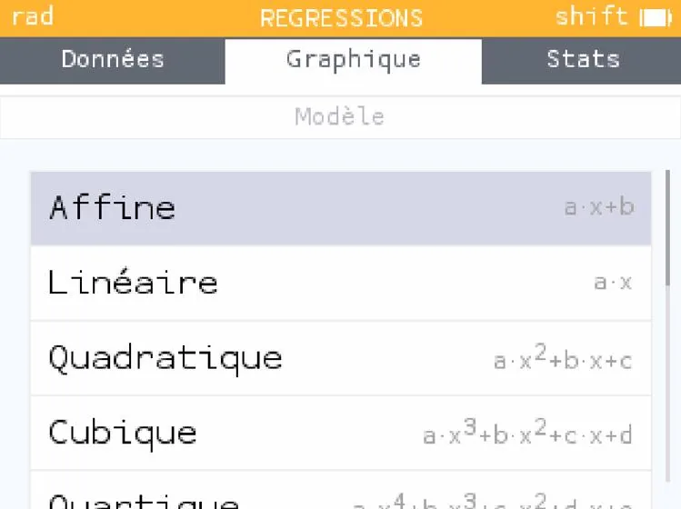
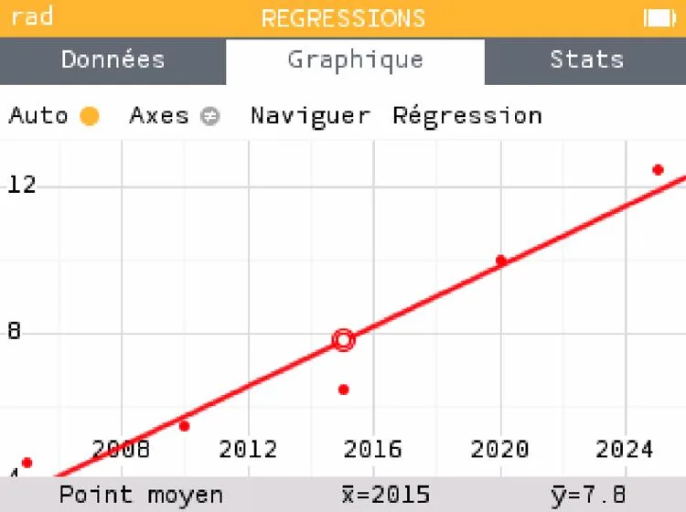

1. Si ce n'est pas déjà fait, afficher le nuage de points correspondant à vos données (méthode « Réaliser un nuage de points avec NumWorks »).

   

2. Se placer sur un point à l'aide des flèches et appuyer sur la touche **OK**.

   

3. Sélectionner **« Affine »** et appuyer sur la touche **OK** pour afficher la droite de régression.

   
