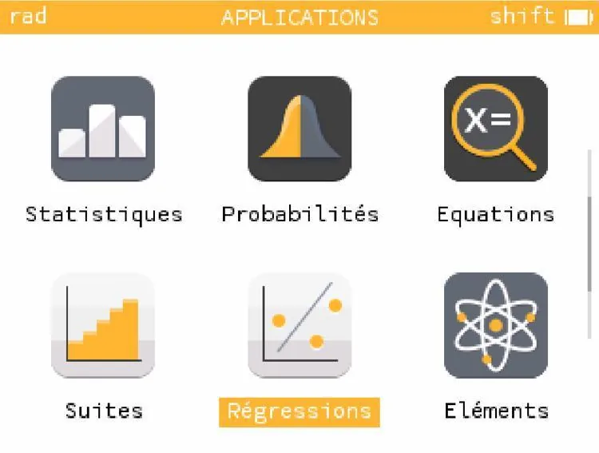
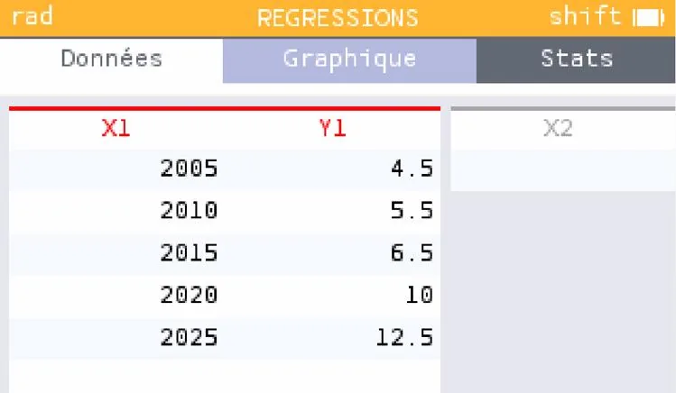
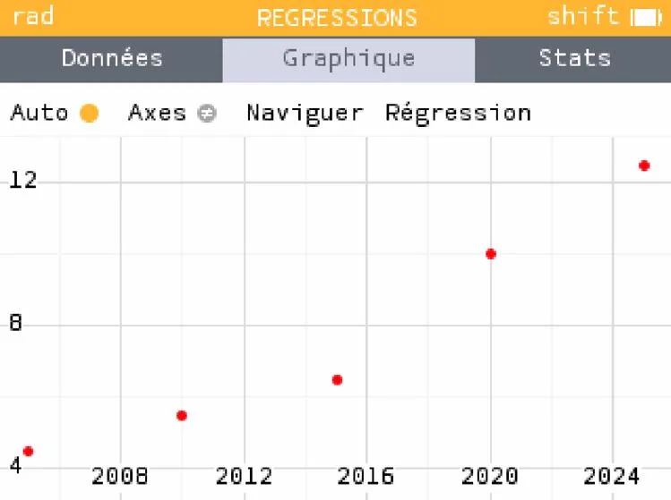

1. Descendre dans le menu principal à l'aide des flèches pour sélectionner le menu **« Régressions »** puis appuyer sur **OK**.

   

2. Saisir les données de l'exercice dans les variables X1 et Y1.

   

3. Aller dans le menu **« Graphique »** et appuyer sur la touche **OK** pour afficher le nuage de points.

   
