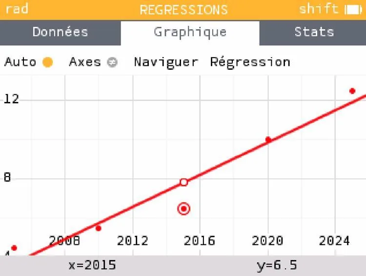
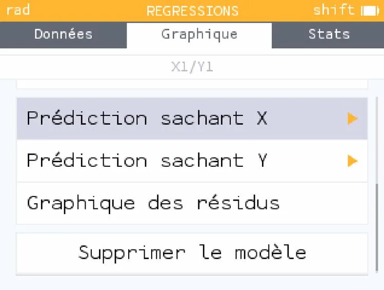
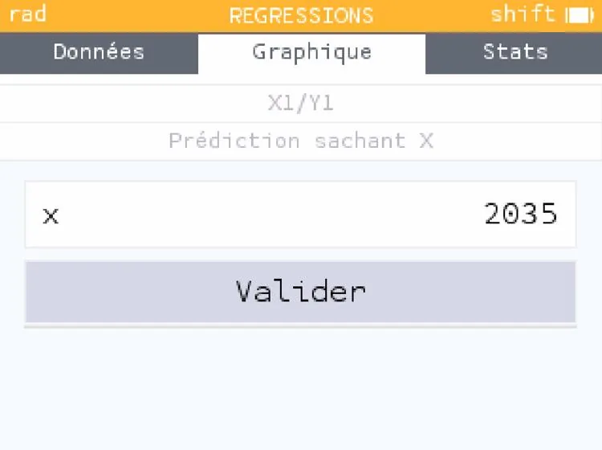
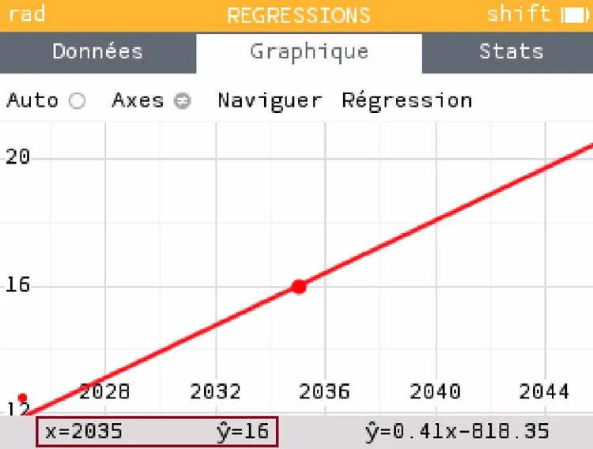

1. Sélectionner un point.

   

2. Appuyer sur la touche **OK**, puis descendre et sélectionner **« Prédiction sachant X »**.

   

3. Saisir la valeur correspondant à la prédiction visée et valider.

   

4. Lire la valeur de $Y$ correspondante.

   
