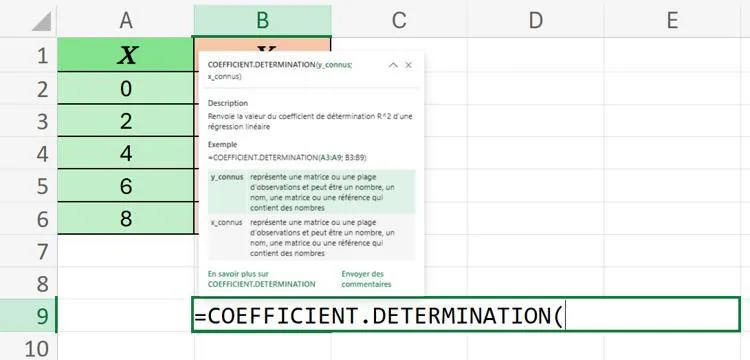
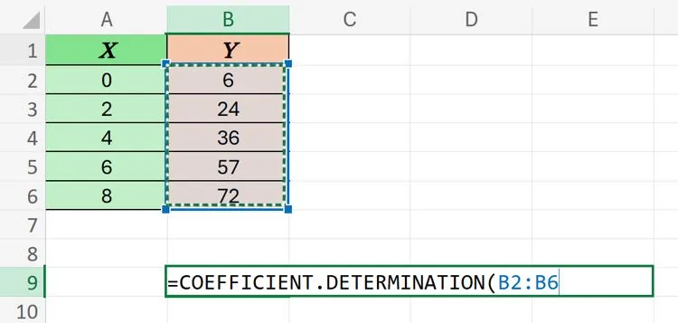
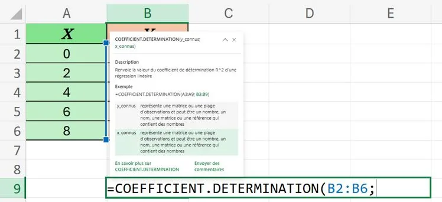
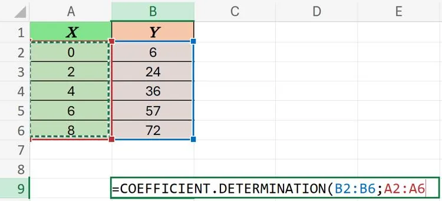
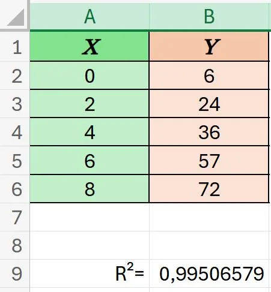

Pour calculer le $R^2$ avec un tableur, on peut utiliser la formule **=COEFFICIENT.DETERMINATION()**.

1. Sélectionner une cellule vide quelconque et écrire **=COEFFICIENT.DETERMINATION(**.

   

2. Sélectionner la plage de la variable $Y$.

   

3. Écrire le symbole **;**.

   

4. Sélectionner la plage de la variable $X$.

   

5. Appuyer sur **« Entrée »**.

   
