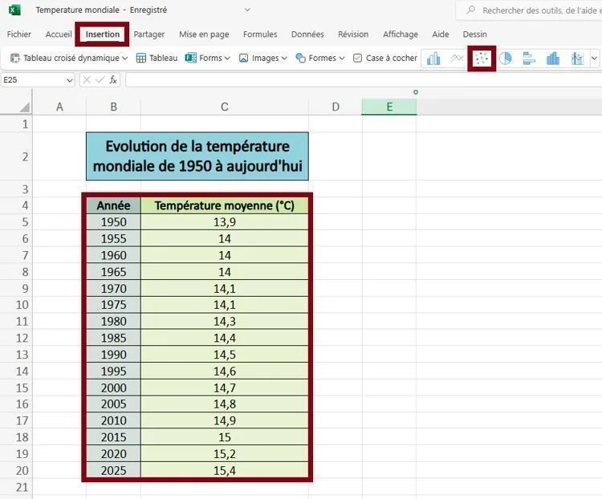
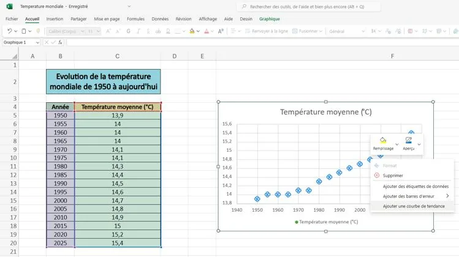
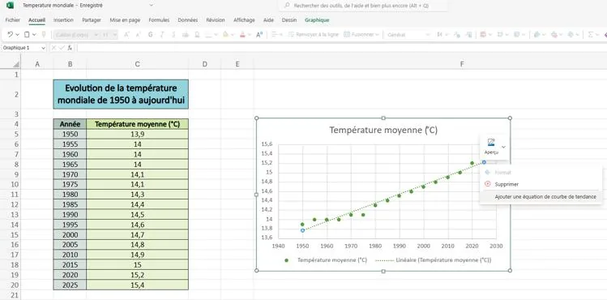
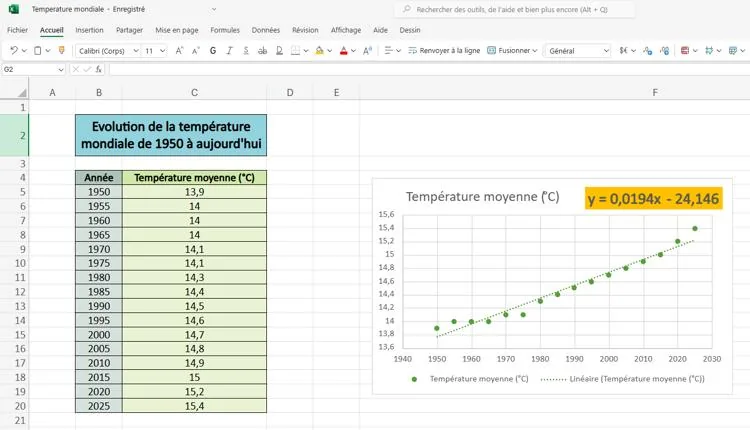

1. Ouvrir le fichier dans le tableur.

2. Sélectionner les données, cliquer sur **« Insertion** », puis sélectionner le nuage de points.

   

3. Faire un clic droit sur un point du nuage et sélectionner **« Ajouter une courbe de tendance »**.

   

4. Faire un clic droit sur la droite de tendance et sélectionner **« Ajouter une équation de courbe de tendance »**.

   

5. L'équation de la droite de régression de la série s'affiche sur le graphique.

   
