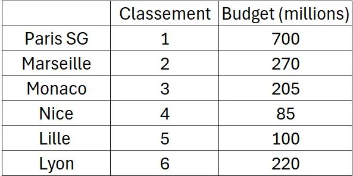

Voici le classement des six premiers clubs de Ligue 1 lors de la saison 2024-2025.

::: problematique
L'argent améliore-t-il les résultats en championnat ?
:::

1. Saisir les données dans NumWorks et tracer le nuage de points.

2. Afficher le $R^2$ et commenter la force du lien entre le classement et le budget des clubs.

3. Certains clubs sous-performent-ils ? D'autres sont-ils surperformants ?
