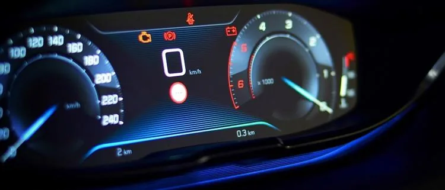
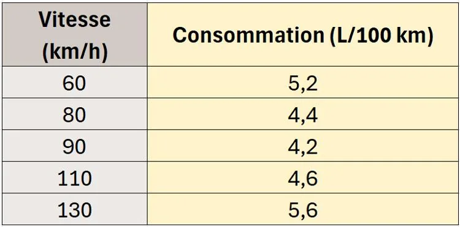

Illan effectue son stage dans un garage automobile. Il s’intéresse à la consommation de carburant en fonction de la vitesse d’une voiture.

Il dispose d’un relevé de données indiquant la consommation (en L/100 km) pour différentes vitesses.

::: problematique
Peut-on exploiter ces données pour estimer la consommation d’une voiture roulant à 30 km/h ?
:::

1. Représenter le nuage de points (consommation en fonction de la vitesse) à l’aide de la calculatrice NumWorks et tracer la droite de régression.

2. Afficher le coefficient de détermination $R^2$. Le modèle est-il pertinent par rapport à la situation ?

3. D’après la droite obtenue, Illan peut-il estimer de façon fiable la consommation d’une voiture à 30 km/h ?
