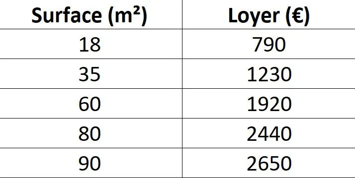

Amadou souhaite louer un appartement à Paris. Il repère une annonce pour un appartement de 45 m² proposé à 840 € par mois (hors charges).

Pour savoir si ce tarif est raisonnable, il compare avec plusieurs annonces similaires dans le même quartier et relève les surfaces et loyers correspondants.

1. Représenter les données sous forme de nuage de points avec NumWorks et tracer la droite de régression.

2. Estimer le loyer moyen attendu pour un appartement de 45 m², à l’aide de la droite obtenue.

3. Comparer cette estimation au prix proposé (840 €). L’appartement visé par Amadou est-il au-dessus, en dessous ou proche du prix du marché ?
