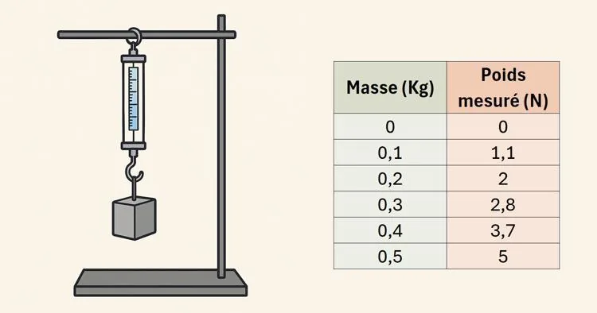

Aroua est cordiste : elle réalise des travaux en hauteur tout en étant sécurisée par un harnais attaché à un mousqueton. Ce mousqueton est conçu pour résister à une force maximale de 9 kN.

Curieuse et soucieuse de sa sécurité, Aroua se pose la question suivante.

::: problematique
Quelle est la masse maximale que l’on peut suspendre à ce mousqueton sans dépasser sa résistance ?
:::

Pour répondre à cette question, elle a suspendu différentes masses à un dynamomètre et noté les forces mesurées. Voici les résultats de ses observations.

1. D'après l'énoncé, quelle est la force maximale (en newtons) que le mousqueton peut supporter sans se casser ?

2. À l'aide de la calculatrice NumWorks, tracer la droite de régression correspondant aux mesures du dynamomètre, puis afficher son équation.

3. En se basant sur les données et sur la force maximale que supporte le mousqueton, déterminer la masse maximale (en kilogrammes) que l’on peut suspendre avant qu’il ne casse.

4. Comparer la formule obtenue par régression avec la formule théorique du poids $P=mg$. Les deux formules donnent-elles des résultats proches ? Expliquer.
