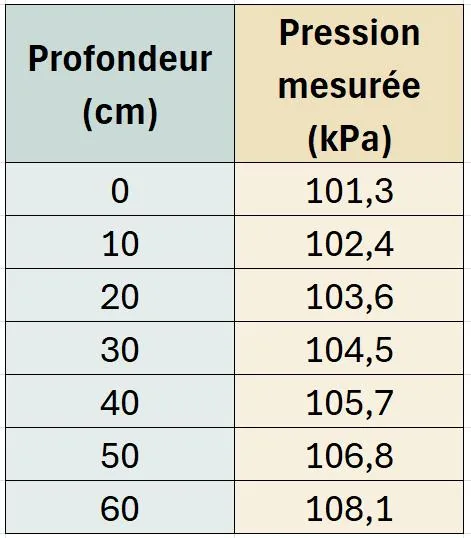

Kassandra a acheté une montre étanche, sur laquelle il est indiqué qu’elle résiste à une pression maximale de 150 kPa. Elle se demande si elle peut plonger au fond de la piscine municipale, qui mesure 5 mètres de profondeur, sans risquer d’endommager sa montre.

Pour le vérifier, elle réalise une séance de travaux pratiques en physique, au cours de laquelle elle mesure la pression à différentes profondeurs dans l’eau à l'aide d'un pressiomètre. Elle obtient alors les données suivantes.

::: problematique
Kassandra pourra-t-elle plonger au fond de la piscine sans abîmer sa montre ?
:::
