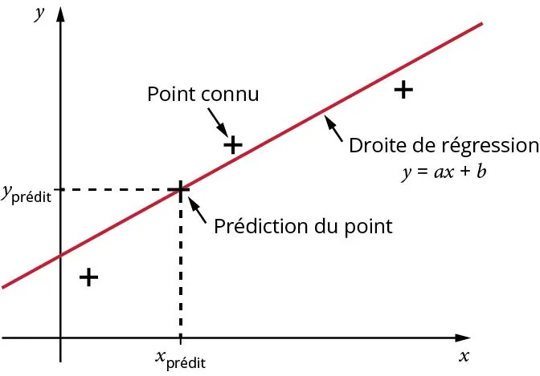

1. **La statistique à deux variables**

   La statistique à deux variables a pour objectif d'étudier la relation entre deux grandeurs mesurées ensemble. On cherche généralement à savoir si une variation de l’une des deux variables est liée à une variation de l’autre.

   Les données sont généralement regroupées dans deux listes numériques, notées $X$ et $Y$, qui contiennent chacune les valeurs prises par une variable.

   **Exemples**

   On peut étudier le lien entre :

   - le prix du tabac et l'année en cours ;
   - l’âge d’un élève et sa taille ;
   - le nombre d'heures de révision et la note obtenue.

2. **Réaliser des prédictions**

   À partir de deux séries numériques $X$ et $Y$, on peut estimer une valeur future ou inconnue grâce à une droite de régression. Cette dernière prend la forme d'une droite, passant au plus près des points de la série, et permettant d'en réaliser une approximation. Elle a pour équation $y=ax+b$.

   
