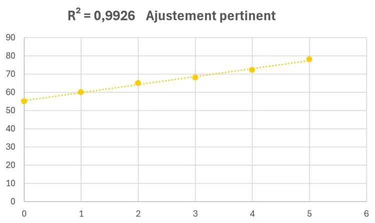
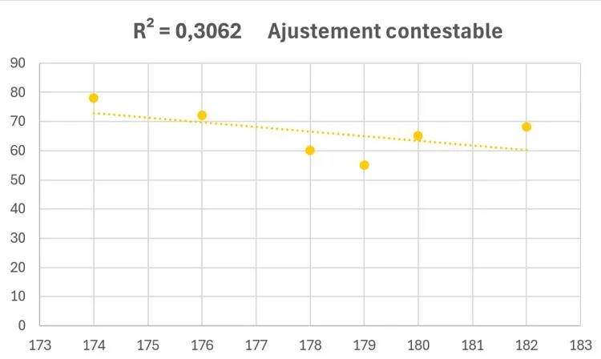

Le coefficient de détermination, noté $R^2$, mesure la proximité entre la droite de régression et les données de la série.

On a toujours $0 \leq R^2 \leq 1$. Plus la valeur du $R^2$ est proche de 1, plus l'ajustement du modèle peut être interprété comme pertinent.

