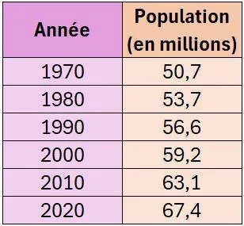

Depuis plusieurs décennies, la population française évolue progressivement. Ces données sont publiées chaque année par l’Insee et permettent d’analyser les grandes tendances démographiques du pays.

::: problematique
Comment modéliser cette évolution afin d'estimer la population française en 2030 ?
:::

:::: competence S'approprier

1. Combien la France avait-elle d'habitants en 2020 ?

::::

:::: competence Analyser-raisonner

2. Comment pourrait-on répondre à la problématique ?

::::

:::: competence Réaliser

3. À l'aide de NumWorks :
   1. Afficher le nuage de points.
   2. Prédire la population française en 2025, puis en 2030.
   3. Afficher le $R^2$ et en déduire la pertinence du modèle.

::::

:::: competence Valider

4. Au 1er janvier 2025, l’Insee estime la population française à 68,6 millions d’habitants. La prédiction obtenue est-elle proche de cette valeur ?

::::

:::: competence Communiquer

5. Rédiger un court mémo illustrant l'évolution de la population française entre 2020 et 2030.

::::
