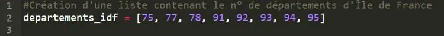

### Créer une liste en Python

En Python, il est possible de créer des listes d'éléments. Il suffit de déclarer une variable liste comme ci-dessous.

- Les crochets [ ] servent à définir la liste.
- Les éléments sont séparés par des virgules.

### Accéder aux données d'une liste en Python

On accède aux éléments d'une liste en Python avec des crochets et l’index en partant de 0.

**Exemple :** j'exécute le code de la console Basthon ci-dessous.

- La variable **a** contient 75, qui est la première valeur de la liste.
- La variable **b** contient 92, qui est la cinquième valeur de la liste.

::: ouvrir https://console.basthon.fr/?script=eJxTdi46vDKxJDM_TyFFvTQvVSEns7gkVSE5P68kNS8xr0QhJ1Uh79AGhZRUhZTDKwsSi0pSc1PzSoqBqg_3AeWA4m5FiXnJqbxcKakI6fjMlDQFW4Voc1MdBXNzILbQUbA0BGIjIDYGYhMgNo3l5QLBRFt0rdEGQKkkTGETsI6Cosy8Eo1ETRgrSRMAtt1AwA
:::
