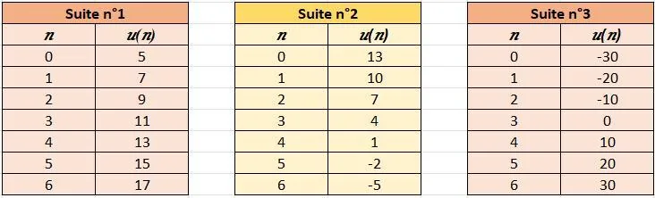

Voici les tableaux de valeurs de trois suites.

1. Pour chacune des trois suites, trouver $u_0$ et $u_4$ dans le tableau.

2. Pour chacune des trois suites, proposer une valeur de $u_7$ qui compléterait le tableau. Expliquer le raisonnement.

3. Pour chacune des trois suites, proposer une valeur de $u_{30}$ qui compléterait le tableau. Expliquer le raisonnement.

   ::: coup-de-pouce x-observation
   :::
