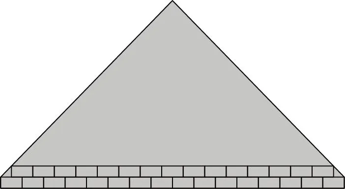

Joséphine réalise un stage dans une entreprise de maçonnerie. Elle veut construire un pignon à l'aide de parpaings réguliers. Elle sait que le mur a une largeur de 16 parpaings et que, à chaque rang, elle utilisera un parpaing de moins. Elle aura donc :

- rangée 1 : 16 parpaings ;
- rangée 2 : 15 parpaings ;
- etc.

::: problematique
Combien de parpaings faut-il prévoir pour réaliser le pignon ?
:::

1. Combien de parpaings Joséphine devra-t-elle placer pour construire le troisième rang ?

2. Combien de rangées en tout devra-t-elle construire pour arriver au sommet du pignon ?

3. Modéliser cette situation à l'aide d'une suite arithmétique, dont on précisera la raison et le premier terme.

4. La formule pour calculer la somme des $n$ premiers termes d'une suite arithmétique est :

   $\text{Somme}=\cfrac{n(u_0 + u_{n-1})}{2}$.

   Calculer le nombre total de parpaings nécessaires à la construction du pignon.

   ::: coup-de-pouce m-somme-formule
   :::

5. Le prix moyen d'un parpaing est de 2,50 €. Chiffrer le budget alloué aux parpaings pour la construction de ce pignon.
