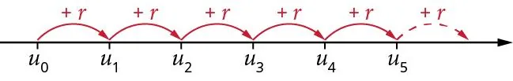
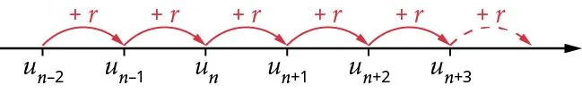

Chaque terme d'une suite arithmétique est lié au terme précédent par la raison $r$.

On a ainsi :

- $u_1=u_0 + r$
- $u_2=u_1 + r$

Mais aussi :

- $u_{14}=u_{13} + r$
- $u_{54}=u_{53} + r$

On peut résumer ce principe par la phrase : « *Chaque terme de la suite est égal au précédent, auquel on a ajouté la raison $r$.* »

Traduite de manière mathématique, cette phrase s'exprime : $u_{n+1} = u_n + r$.

Cette manière de définir une suite est dite par récurrence.
