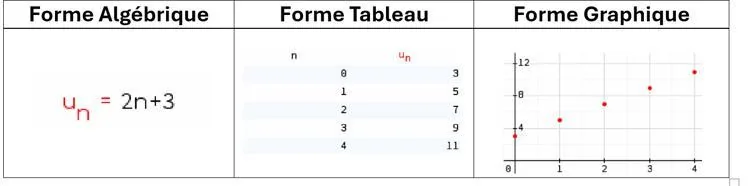

Comme pour les fonctions, on peut représenter les suites numériques sous différentes formes :

- la forme algébrique explicite ;
- la forme tableau ;
- la forme graphique.

**Exemple :** les représentations de la suite $u(n)=2n+3$.

**Remarque :** afin de simplifier les notations, $u(n)$ est souvent écrit $u_n$. Il en va de même pour les différentes images de la suite. Par exemple, $u(5)$ s'écrit généralement $u_5$.
