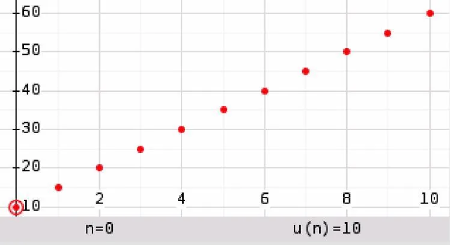

Identifier la raison des suites arithmétiques suivantes.

1. $2$ ; $6$ ; $10$ ; $14$ ; $18$

2. $-12$ ; $-7$ ; $-2$ ; $3$ ; $8$

3. $u_{n+1} = u_n + 12$

4. $u_{n+1} = u_n - 20$

5. La suite représentée ci-dessous.

   
