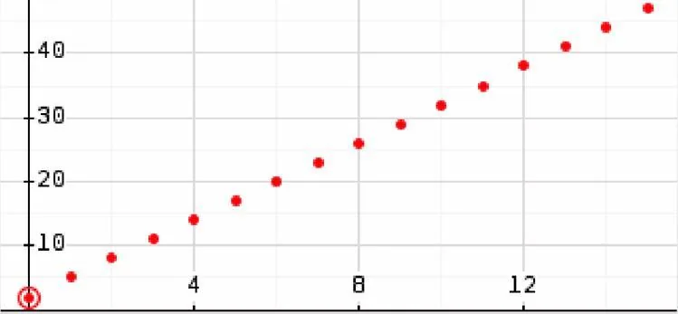
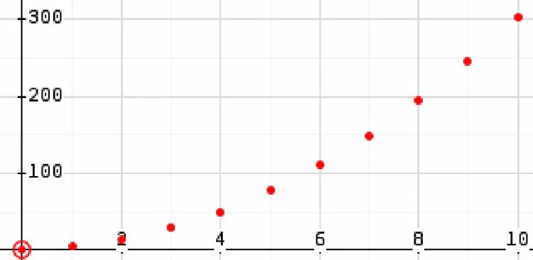
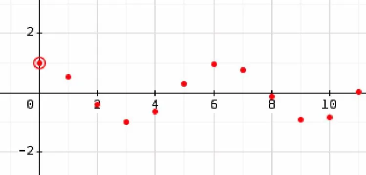
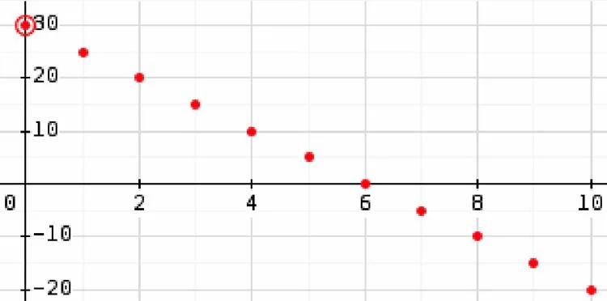
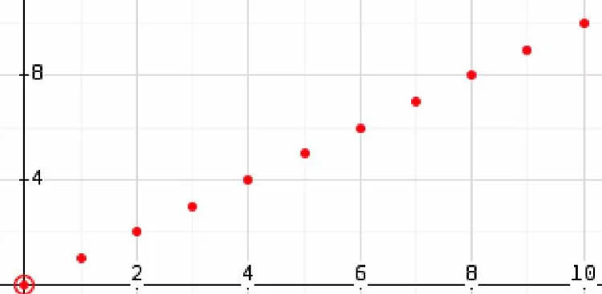
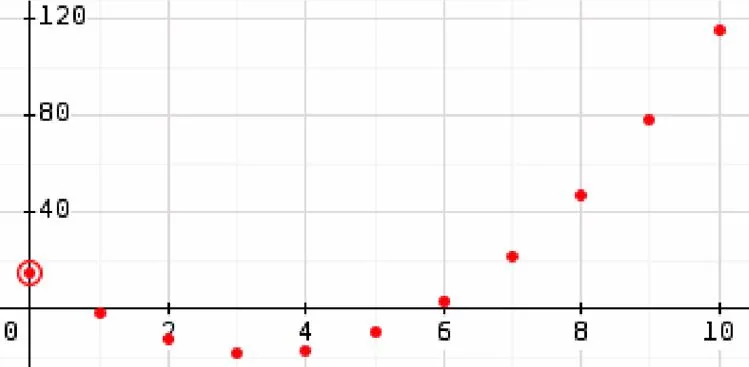

Parmi ces représentations, lesquelles modélisent une suite arithmétique ?

### Représentation 1

### Représentation 2

### Représentation 3

### Représentation 4

### Représentation 5

### Représentation 6

