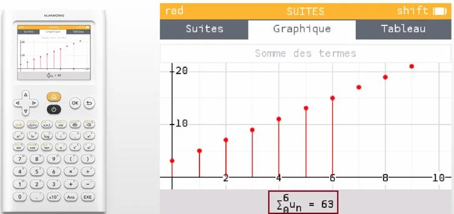

1. Tracer la suite à l'aide de NumWorks.

2. À l'aide des flèches, se positionner sur un des points de la suite, puis appuyer sur OK.

   

3. **« Somme des termes »** est sélectionné. Appuyer sur OK.

   

4. À l'aide des flèches, sélectionner le terme à partir duquel on veut faire la somme (en général, on part du terme $u_0$). Appuyer sur OK.

   

5. Sélectionner le dernier terme de la somme et appuyer sur OK pour pouvoir lire le résultat affiché en bas.

   Attention : il faut penser que l'on commence à $u_0$. Donc, par exemple, pour réaliser la somme des 7 premiers termes de la suite $u_n$, il faut sélectionner les termes de $u_0$ à $u_6$.

   
