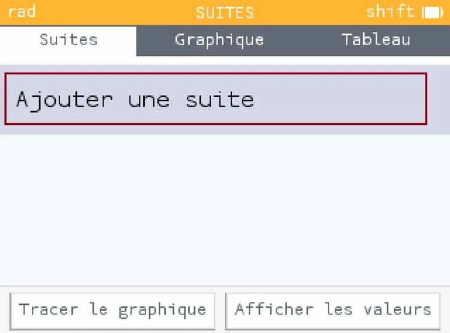
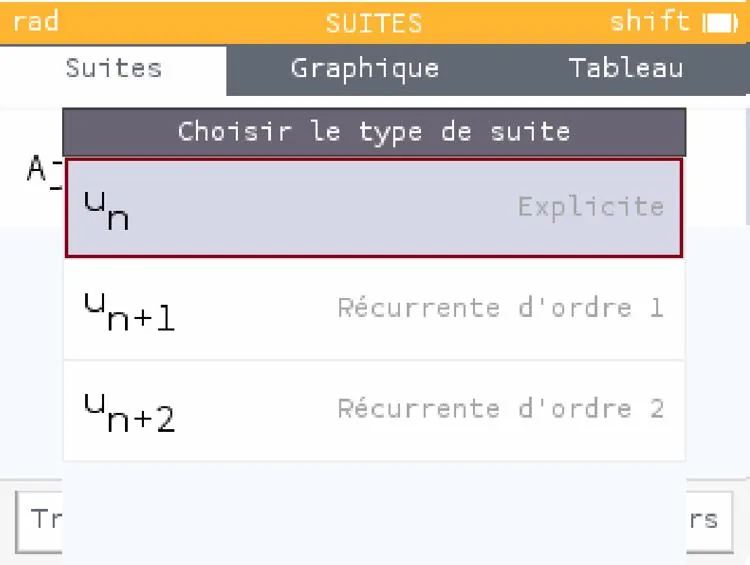
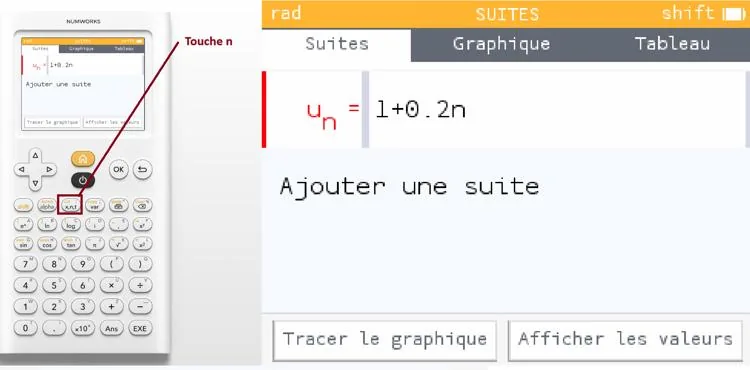
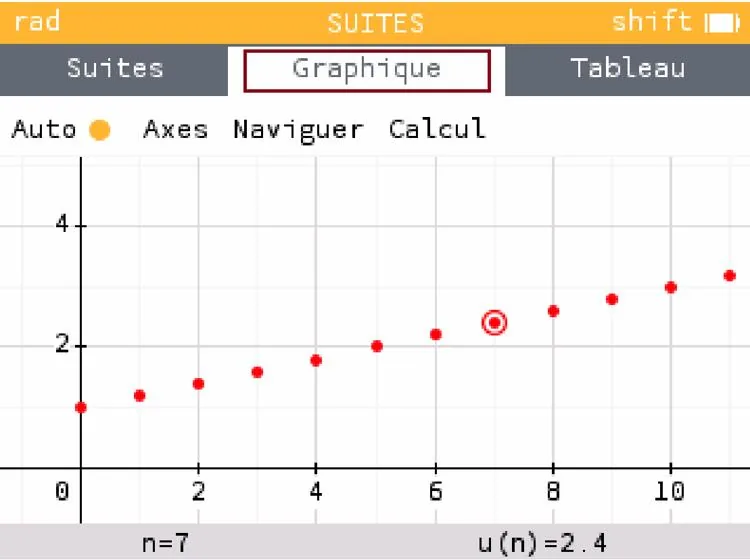

1. Ouvrir NumWorks.

   

2. Descendre dans le menu à l'aide des flèches, sélectionner **« Suites »** puis appuyer sur OK.

   

3. **« Ajouter une suite »** est sélectionné. Appuyer sur OK.

   

4. La suite de type **« Explicite »** est sélectionnée. Appuyer sur OK.

   

5. Saisir la formule explicite de la suite à l'aide de la touche $n$ puis appuyer sur OK.

   

6. À l’aide des flèches, sélectionner **« Tracer le graphique »**.

   
