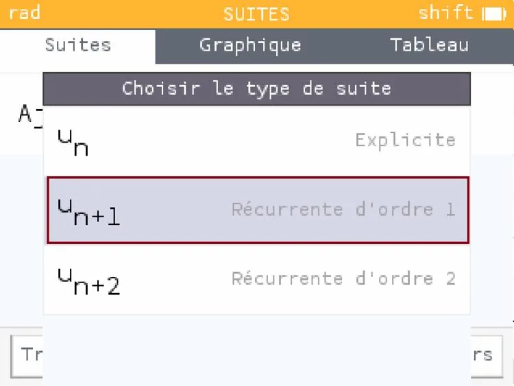
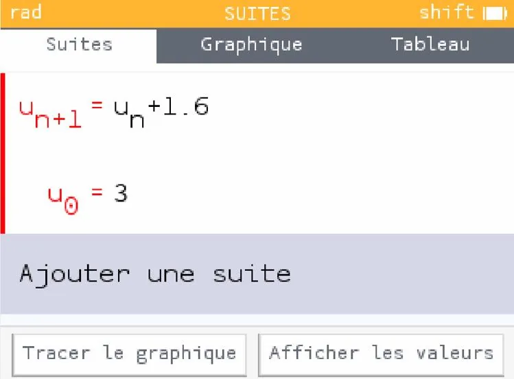
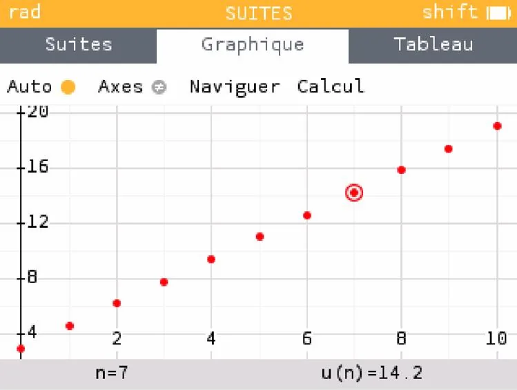

1. Ouvrir NumWorks.

   

2. Descendre dans le menu à l'aide des flèches, sélectionner **« Suites »** puis appuyer sur OK.

   

3. **« Ajouter une suite »** est sélectionné. Appuyer sur OK.

   

4. Sélectionner la suite de type **« Récurrente d'ordre 1 »** puis appuyer sur OK.

   

5. Saisir la valeur du premier terme et la relation de récurrence puis appuyer sur OK.

   

6. À l’aide des flèches, sélectionner **« Tracer le graphique »**.

   
