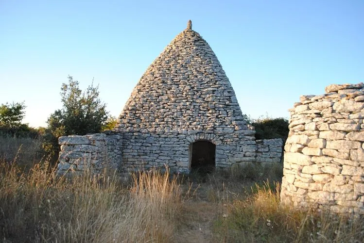
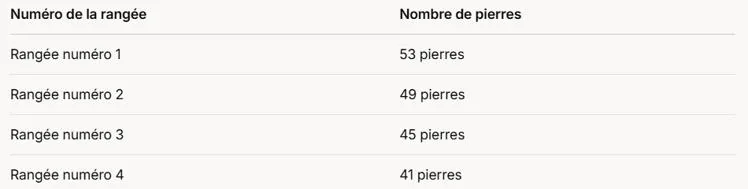

Une borie est une petite construction en pierres sèches qu’on trouve surtout en Provence. Elle a souvent une forme ronde ou conique, avec un toit en dôme fait de pierres empilées. Les paysans l’utilisaient comme abri ou pour ranger leurs outils.

Afin de construire le toit, on empile plusieurs rangées de pierres. En étudiant les rangées de pierres d'une borie, on trouve les données suivantes.

Combien de pierres sont nécessaires à la construction du toit de cette borie ?
