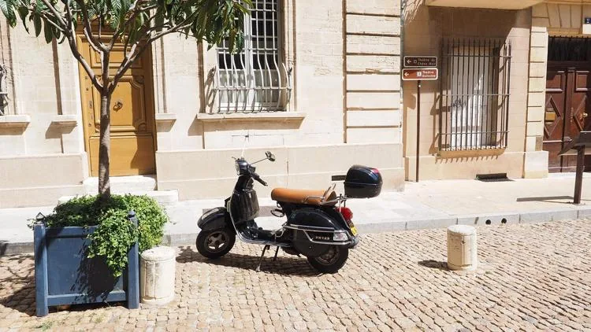

Rayan se rend à son stage en scooter. Son réservoir, récemment rempli, contient 12 litres d’essence. Son scooter consomme en moyenne 2,30 L pour 100 km.

1. Un aller-retour entre son domicile et son lieu de stage représente 32 km. Quelle quantité d’essence consommera-t-il pour ce trajet ?

2. On suppose qu’il utilise son scooter uniquement pour aller et revenir du stage. Modéliser l’évolution du niveau de son réservoir en fonction du nombre d’allers-retours à l’aide d’une suite arithmétique.

3. Combien d’allers-retours pourra-t-il effectuer avant de vider son réservoir ?

4. Combien de kilomètres aura-t-il parcouru en tout ?
