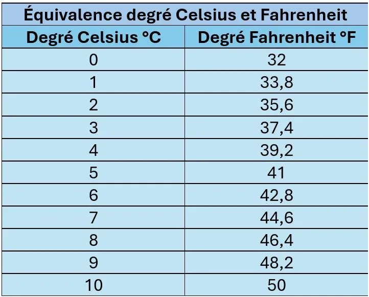

Marco part aux États-Unis. Là-bas, les températures sont exprimées en degrés Fahrenheit, alors Marco cherche un moyen d'effectuer la conversion facilement. Il dispose du tableau suivant.

1. Quel type de suite forme celle générée par les degrés Fahrenheit ?

2. À l'aide de la formule $u_n = u_0 + n\times r$, calculer combien de degrés Fahrenheit font 25 °C.

3. Tracer la suite avec NumWorks.

4. Il a été annoncé aux informations que, le lendemain, il ferait plus de 100 °F. Cela vous paraît-il possible ?
