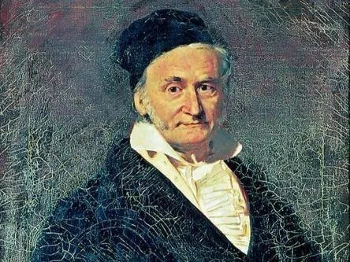

Carl Friedrich Gauss était un mathématicien célèbre qui, enfant, a surpris son maître d'école par sa rapidité à résoudre un problème. Voici le problème qui lui avait été posé : « *Calculez la somme de tous les nombres entiers de 1 à 100.* »

Pour comprendre comment Gauss a résolu ce problème très rapidement, répondez aux questions suivantes, étape par étape.

1. **Observer**

   Voici la somme que l'on a demandé de calculer à Gauss.
   $1+2+3+4+...+97+98+99+100$

2. **Analyser**

   On peut associer les nombres par paires en prenant le premier avec le dernier, le deuxième avec l'avant-dernier, etc. On obtient ainsi l'addition suivante :
   $(1+100)+(2+99)+(3+98)+(4+97)+...$

3. **Calculer**
   1. Quelle est la somme de chaque paire obtenue ?
   2. Combien y a-t-il de telles paires ?
   3. Calculer alors facilement la somme totale.

4. **Généraliser**

   1. Avec la même méthode, calculer la somme des nombres entiers de 1 à 200.

   2. Retrouver ce résultat avec la formule $\text{Somme}=\cfrac{n(u_0 + u_{n-1})}{2}$.

      Vous venez de découvrir, grâce à Gauss, une méthode rapide pour calculer la somme d'une suite arithmétique. C'est d'ailleurs cette méthode qui est à l'origine de la formule $\text{Somme}=\cfrac{n(u_0 + u_{n-1})}{2}$.

      
