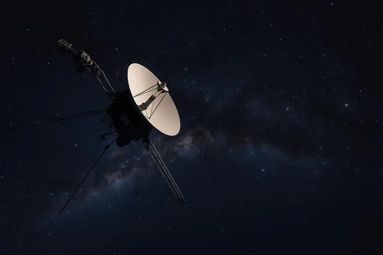

En 1977, la NASA a lancé la sonde Voyager 1 dans le but d’explorer l’espace interplanétaire et de collecter des données scientifiques. En 1980, la sonde avait déjà parcouru 1 370 304 000 km. C'est à cette époque qu'elle a stabilisé sa vitesse. Depuis, elle s’éloigne de la Terre à une vitesse constante de 16,6 kilomètres par seconde. À ce jour, elle constitue l’objet construit par l’humanité le plus éloigné de notre planète.

1. Calculer la distance parcourue par la sonde en une journée à sa vitesse de croisière.

2. En déduire la distance parcourue en une année (365 jours).

3. Modéliser la distance totale parcourue (en km) en fonction du nombre d’années écoulées depuis 1980, à l’aide d’une suite arithmétique. On précisera la raison et on exprimera le premier terme.

4. Estimer la distance de la sonde à la Terre en 2025, en supposant que sa vitesse est restée constante depuis 1980.

   
