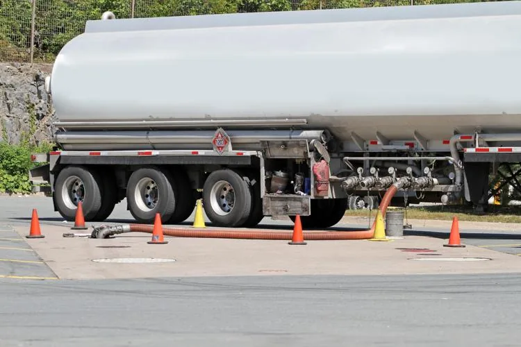

Alex travaille pour une entreprise de transport. Il conduit un camion-citerne d’une capacité de 40 000 litres et est actuellement en train de faire le plein.

Le compteur indique qu’il a déjà rempli 2 500 litres. Pour estimer le temps de remplissage, il déclenche son chronomètre : au bout de 1 minute, le volume atteint 3 150 litres, puis 3 800 litres après 2 minutes, et ainsi de suite.

::: problematique
Combien de temps Alex doit-il encore attendre ?
:::

:::: competence S'approprier

1. Lecture de l'énoncé :
   1. Quelle est la capacité totale du camion-citerne d’Alex ?
   2. Quel est le débit de la pompe, en litres par minute ?

::::

:::: competence Analyser-raisonner

2. Modéliser cette situation à l’aide d’une suite arithmétique, en précisant son premier terme et sa raison.

::::

:::: competence Réaliser

3. À l'aide de NumWorks :
   1. Tracer la suite.
   2. À partir de quel rang la suite dépasse-t-elle 40 000 litres ?

::::

:::: competence Valider

4. Utiliser la formule $u_n = u_0 + n \times r$ pour vérifier la réponse précédente.

::::

:::: competence Communiquer

5. Répondre à la problématique en deux phrases courtes et précises.

::::
