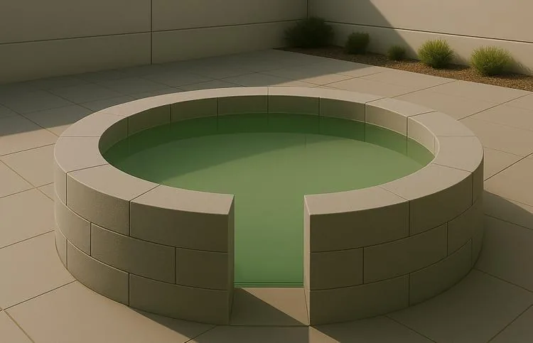

Un maçon souhaite construire un bassin circulaire en utilisant des parpaings pour réaliser la bordure. Le bassin aura un diamètre de 2 m, mesuré à partir de l’extérieur du muret. Une ouverture de 0,52 m sera laissée dans la bordure pour permettre l’accès à l’eau.

::: problematique
Quelle est la longueur de parpaings nécessaire à la construction de la bordure de ce bassin ? Quel est l'angle d'ouverture du bassin ?
:::

::: coup-de-pouce x-bassin
:::

1. Calculer le rayon $R$ du bassin.

2. Calculer la circonférence $C$ du bassin (arrondir au centième).

3. Calculer la longueur du muret (arrondir au centième).

4. En utilisant la simulation GeoGebra ci-dessous :

   - Ajuster l'arc $\overset{\frown}{AB}$ à la dimension de l'ouverture du bassin.
   - Relever l'angle $\alpha$ d'ouverture du bassin en degrés (°).

   ::: ouvrir https://www.geogebra.org/classic/pafuvvkn
   :::

5. Convertir l'angle $\alpha$ en radians (rad) à l'aide de l'émulateur de la calculatrice NumWorks.

6. Répondre à la problématique de l'activité.
