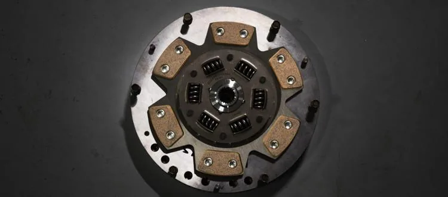
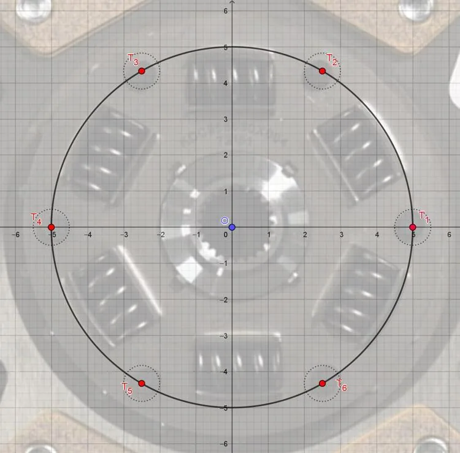

Une entreprise réalise des pièces mécaniques pour l'industrie automobile. Un opérateur doit programmer une machine à commande numérique pour percer 6 trous régulièrement espacés dans un disque métallique. Le centre du disque est à l'origine d'un repère et les trous doivent être positionnés avec précision sur un cercle de rayon $R = 5 \, \text{cm}$.

L'opérateur doit saisir dans le programme de la machine les coordonnées cartésiennes $(x \,; y)$ de chaque trou, qui sont déterminées à partir de l'angle et du rayon.

::: problematique
Quelles coordonnées l'opérateur doit-il saisir pour chacun des six trous ?
:::

1. Déterminer l'angle $\alpha$, en degrés, entre deux trous consécutifs.

2. Convertir cet angle en radians.

3. Déterminer graphiquement les coordonnées des trous $T_1$ et $T_2$.

4. Calculer $R\times \cos\alpha$ et $R \times \sin\alpha$ et comparer les résultats avec les coordonnées du trou $T_2$. (Arrondir au dixième si nécessaire.)

5. En déduire les coordonnées des autres trous ($T_3$ à $T_6$) en utilisant la symétrie du cercle.

6. Répondre à la problématique de l'activité.
