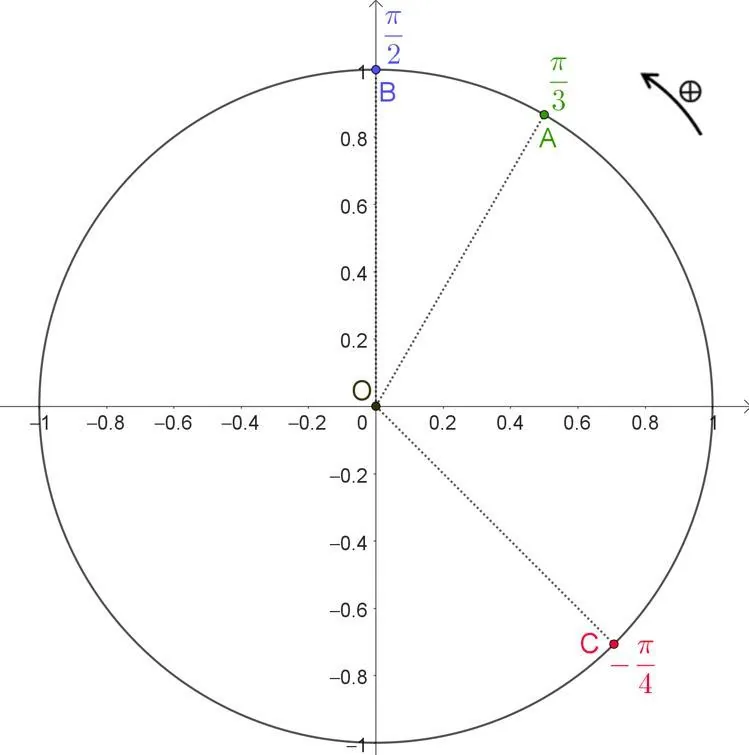

**Définition :** le cercle trigonométrique est un cercle orienté de rayon 1 centré sur l’origine d’un repère orthonormé.

Le sens positif de rotation correspond au sens inverse du déplacement des aiguilles d’une montre.

Tout point du cercle est l’image d’un nombre réel.

**Exemples**

- Le point $A$ est l’image de $\frac{\pi}{3}$.
- Le point $B$ est l’image de $\frac{\pi}{2}$.
- Le point $C$ est l’image de $-\frac{\pi}{4}$.
