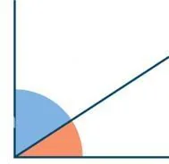

**Angles complémentaires** ($x$ et $\frac\pi2-x$)

::: ouvrir https://www.geogebra.org/classic/ud2ckdyv
:::

**Propriétés**

- Le cosinus d'un angle est égal au sinus de son angle complémentaire : $\cos(x)=\sin(\frac{\pi}{2}-x)$.
- Le sinus d'un angle est égal au cosinus de son angle complémentaire : $\sin(x)=\cos(\frac{\pi}{2}-x)$.
