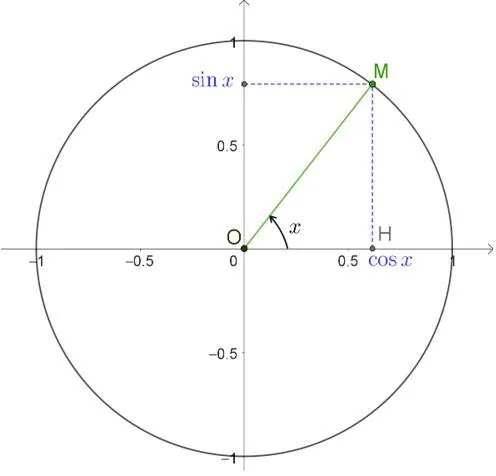

**Définition :** pour tout nombre réel $x$, dont l'image est le point $M$ sur le cercle trigonométrique :

- le cosinus de $x$, noté $\cos x$, est l'abscisse du point $M$ ;
- le sinus de $x$, noté $\sin x$, est l'ordonnée du point $M$.

Le point $M$ a donc pour coordonnées $M(\cos x;\sin x)$.

Propriétés

- Le cosinus d'un nombre réel est toujours compris entre $-1$ et 1 : $-1\leq\cos x\leq1$.

- Le sinus d'un nombre réel est toujours compris entre $-1$ et 1 : $-1\leq\sin x\leq1$.

- En appliquant le théorème de Pythagore dans le triangle $OHM$ rectangle en $H$ ($H$ étant le projeté du point $M$ sur l'axe des abscisses), on obtient : $\cos^2 x+\sin^2x=1$.
