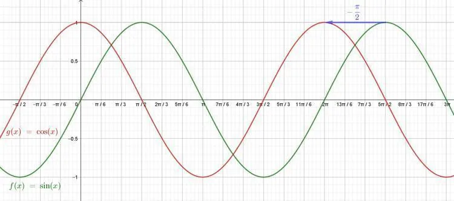
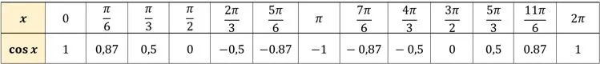
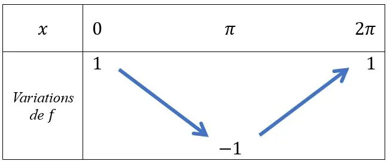

La fonction cosinus, définie pour tout $x$ par $f(x)=\cos x$, est une fonction périodique de période $2\pi$. Sa représentation graphique est une sinusoïde qui s'obtient en décalant de $\frac{\pi}{2}$ vers la gauche la courbe représentative de la fonction sinus.

### Tableau de valeurs

### Tableau de variations

