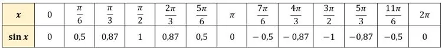
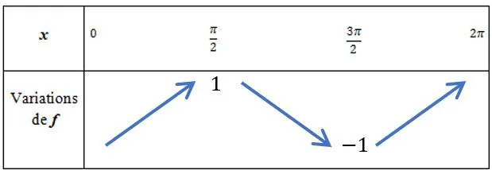

::: ouvrir https://www.geogebra.org/classic/mnc6zjha
:::

On étudie la fonction $f$ définie par $f(x)=\sin x$ sur l'intervalle $[0\,;2\pi]$.

La fonction sinus est une fonction périodique de période $2\pi$.

### Tableau de valeurs

### Tableau de variations

