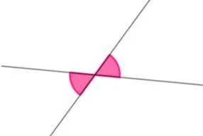

**Angles opposés** ($x$ et $-x$)

::: ouvrir https://www.geogebra.org/classic/vzwq7xcf
:::

**Propriétés**

- Deux angles opposés ont le même cosinus : $\cos (-x)=\cos(x)$.
- Deux angles opposés ont des sinus opposés : $\sin (-x)=-\sin(x)$.
