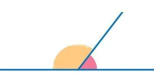

**Angles supplémentaires** ($x$ et $\pi-x$)

::: ouvrir https://www.geogebra.org/classic/ak7ghghh
:::

**Propriétés**

- Deux angles supplémentaires ont des cosinus opposés : $\cos(\pi-x)=-\cos(x)$.
- Deux angles supplémentaires ont le même sinus : $\sin(\pi-x)=\sin(x)$.
